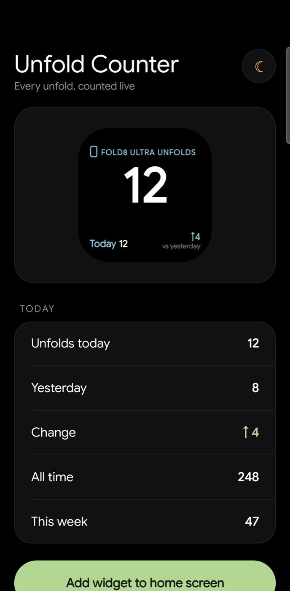
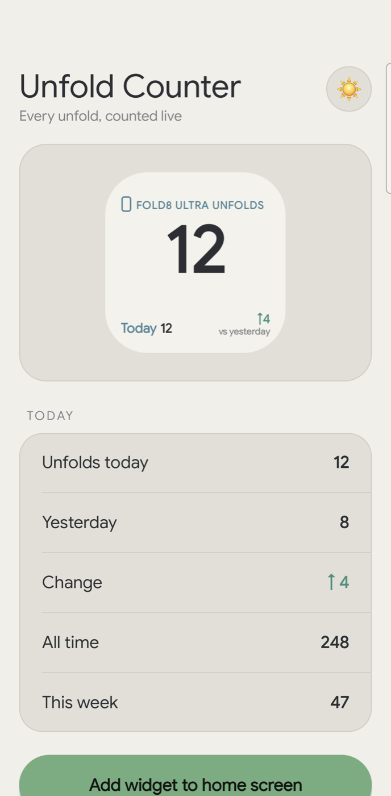
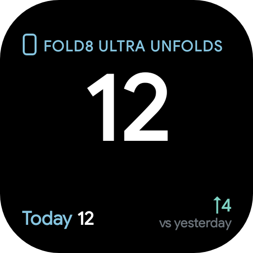
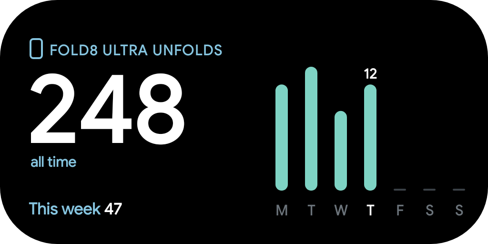
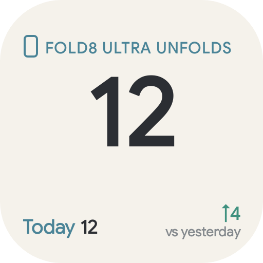
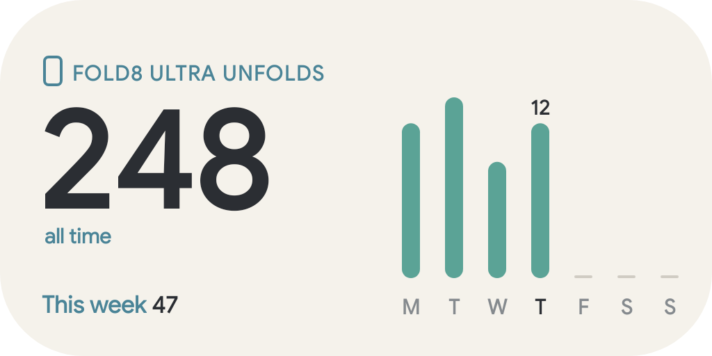

# Fold Counter

Counts how many times a foldable phone (built for the Samsung Galaxy Z Fold series) has been **unfolded**, with home-screen widgets styled like an unlock counter. The widget header shows your phone's own model name, for example "FOLD8 ULTRA UNFOLDS".

- Dark and light widgets, in 2x2 (today and vs yesterday) and 4x2 (all time, this week, Mon-Sun bars).
- App screen with a dark/light toggle and a stats list.
- Everything stays on the phone: no internet permission.

## Screenshots

Sample data, shown for a Galaxy Z Fold 8 Ultra.

| App (dark) | App (light) |
| :---: | :---: |
|  |  |

| 2x2 widget | 4x2 widget |
| :---: | :---: |
|  |  |
|  |  |

## How it counts

A foreground service listens to the hinge-angle sensor (`Sensor.TYPE_HINGE_ANGLE`).
The hinge counts as closed at 15 degrees or less and open at 45 degrees or more.
Going from closed to open counts one unfold. The gap between the two thresholds stops one
slow open from counting twice. Counting starts when the app is installed, and the service
restarts after a reboot.

On a phone without a hinge sensor the app says so and shows a "Test: +1 unfold" button.

## Phone name

The name comes from the phone model: a built-in table of Samsung model numbers first,
then the system marketing name, then the raw model string.

## Build

No Gradle needed. Requires JDK 17 and an Android SDK with build-tools 36 and platform android-36.

```bash
./build.sh                       # -> FoldCounter.apk
adb install -r FoldCounter.apk
```

Then long-press the home screen, open Widgets and add Fold Counter, or use the button in the app.

Requires Android 12 or newer (minSdk 31).

## Status

Tested on a phone without a hinge (counts via the test button and widget drawing). Real hinge counting is not yet verified on a Fold.
